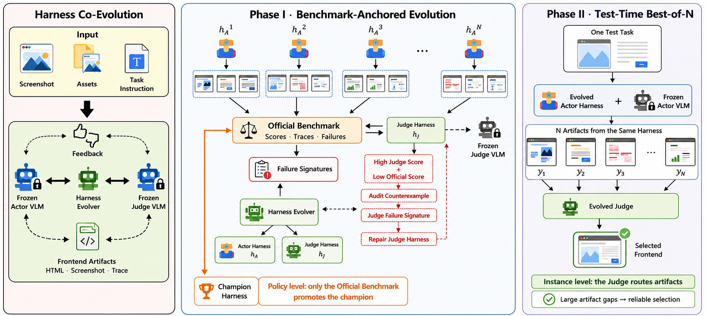

# GRADE: Granularity-Aware Delegation of Evaluation for Evolving Frontend Agent Harnesses

Code and data supplement for *"What a Cheap Judge May Decide:
Granularity-Aware Delegation of Evaluation for Evolving Frontend Agent
Harnesses"*.

> **TL;DR** — A cheap judge may be trusted to order one task's webpages and to
> allocate expensive official evaluations; it may not be trusted to promote a
> harness. GRADE turns that split into a division of authority and evolves
> both sides under it: the judge screens candidates and routes final
> artifacts, the benchmark alone promotes champions, and benchmark-verified
> counterexamples repair the judge.



## Abstract

Optimizing the prompts, tool use, and repair procedures around a frozen
multimodal model can improve frontend generation without updating its
weights. However, searching these harnesses requires costly and sometimes
noisy benchmark evaluations, and a cheap judge that compares individual
webpages accurately may still fail to identify the harness with better
average performance. We present GRADE (granularity-aware delegation of
evaluation), which jointly evolves actor and judge harnesses while assigning
them distinct roles in search and deployment. The judge shortlists candidate
harnesses for official evaluation; repeated benchmark assessments and
confirmation tasks disjoint from selection determine whether a candidate is
promoted. Benchmark failures guide localized actor-harness updates, while
candidates that the judge over-scores provide benchmark-verified
counterexamples for repairing the judge harness. After search, the judge
selects the final webpage from multiple generations of an accepted harness or
a portfolio of confirmed siblings. This division reflects a difference in
decision granularity: webpage comparisons exploit variation between
individual generations, whereas harness comparisons must resolve smaller
differences in average performance. We examine this distinction through
frozen-pool ranking experiments, selection-noise analysis, and a control that
delegates promotion to the judge. We also audit benchmark-specific behavior
and evaluate routing against self-repair at matched actor-call budgets. On
WebGen-Bench, Vision2Web, and Interaction2Code, evolved harnesses improve
over the minimal harness in all nine model–benchmark combinations by 5.4–8.7
points. At matched official-evaluation budgets, GRADE outperforms five
alternative search methods. On a sealed Vision2Web batch, selecting among
four webpages adds 3.8 points within one harness and 5.3 points across a
four-harness portfolio, relative to a single generation.

## Main results

Gated harness evolution, Minimal → evolved champion, on benchmark
confirmation sets (paper Table 2):

| Base model | WebGen-Bench | Vision2Web | Interaction2Code |
|---|---:|---:|---:|
| Qwen3.5-9B (primary actor) | 53.4 → 59.2 (**+5.8**) | 49.5 → 56.4 (**+7.0**) | 48.2 → 56.8 (**+8.7**) |
| Gemma-4-26B | 50.9 → 59.6 (+8.7) | 52.4 → 59.8 (+7.4) | 50.7 → 57.6 (+6.9) |
| Qwen3-VL-8B | 53.3 → 60.2 (+6.9) | 56.1 → 62.0 (+5.9) | 54.4 → 59.8 (+5.4) |

All nine arms improve, by +5.4 to +8.7 points. At matched
official-evaluation budget, gated evolution beats five alternative searches
(paper Table 1); on the sealed Vision2Web deployment batch, judge routing
among four webpages adds +3.8 points within one harness and +5.3 points
across a four-harness portfolio, where a self-repair control at the same
actor-call budget adds nothing significant (paper Table 3). Handing the
champion promotion decision to the judge instead turns a reported +5.8 into a
confirmed −4.0 (the paper's policy hand-off control).

## Supplement documents

| Document | Contents |
|---|---|
| [`docs/proofs.md`](docs/proofs.md) | Proofs of Propositions 1–2 and the pairwise relations behind Corollary A, with constants and scope remarks |
| [`docs/algorithm.md`](docs/algorithm.md) | The GRADE loop as pseudocode (one search round + deployment routing) |
| [`docs/judge-grid.md`](docs/judge-grid.md) | Full three-lineage judge grid: pairwise accuracy, $R_k$/Spearman, HJ/LB by variant and benchmark, binned accuracies, Thurstone fits, computation protocol |
| [`docs/decoding.md`](docs/decoding.md) | Frozen decoding specification (judge and actor temperatures, top-$p$, confidence threshold $\gamma$) |

## Repository layout

```
harnesses/           the evolved harnesses (the primary artifacts)
  webgen/            WebGen-Bench actor harnesses: gen0.py (Minimal),
                     gen3b.py (evolved champion), p7_emitatomicit.py
                     (policy hand-off champion), atk1.py, atk2.py
                     (adversarial attack harnesses)
  v2w_actor/         Vision2Web actor harnesses: gen0.py (Minimal),
                     gen10.py (champion), gen13b.py (white-box adversarial
                     attack), poisonA/B/C.py (heavy-scaffold ablation arms)
  v2w_judge/         the Vision2Web judge lineage jgen0 -> jgen4 (the
                     challenge-hardened judge used for routing), the
                     rendering + judge driver rejudge_pairs.py, and the
                     sealed-batch re-routing selector select_sealed_jgen4.py
data/                frozen per-instance measurements, by benchmark
  webgen/            per-site official task labels (11 arms), 2,634
                     evaluation slots, batch definitions, archived frozen
                     verdicts, derived packs
  v2w/               phase-I/II official summaries, judge lineage, GAN
                     rounds, BoN replays, noise, cost accounting, the
                     ladder evidence batch, sealed-routing artifacts, the
                     120-pair exam, campaign reports (sources/)
  i2c/               the Interaction2Code frozen evidence pack: the
                     end-to-end exploit case 68_2__A2 (screenshots, HTML,
                     raw judge responses, official record, CCEF record,
                     replay source) and the case index
analysis/            verification scripts (below); run_all.sh runs all
archive/             the original as-run analysis scripts, kept for
                     provenance. They read the lab's frozen corpus (paths
                     redacted to <frozen_corpus>) and are documentation,
                     not runnable entry points.
docs/                proofs, pseudocode, judge grid, decoding spec
assets/              figures
```

## Quick start

```
cd analysis
bash run_all.sh        # Python 3, standard library only, offline
```

Each script recomputes a slice of the paper's numbers **from the shipped
per-instance data** and prints PASS/FAIL against the paper's values — 151
checks across 10 scripts, all passing offline on any machine with Python 3.

To run a harness against your own endpoint:

```
python3 harnesses/webgen/gen3b.py --task-json task.json --workdir out/ \
    --model <your-model> --base-url https://api.example.com/v1 \
    --api-key-file ./.api_key --temperature 0.4
```

The `--model` / `--base-url` / `--api-key-file` defaults in the shipped files
are placeholders; point them at any OpenAI-compatible endpoint serving a
comparable multimodal model. Judges take
`--exam/--renders/--datasets/--out/--workdir` (see
`harnesses/v2w_judge/rejudge_pairs.py`, which renders pages and drives any
judge with the same contract). Harnesses obey the evolution contract stated
in their docstrings: one frozen model per run, no access to evaluation
artifacts, no task-specific content, bounded call budgets. Decoding settings
for every frozen measurement are in [`docs/decoding.md`](docs/decoding.md).

## Paper claim → where it is verified

| Paper item | Verified by |
|---|---|
| Table 2, WebGen column (53.4 → 59.2, +5.8 [+1.4,+10.2]) and the P2 policy hand-off reversal (−4.0; Table 3 context) | `verify_webgen_maintable.py` |
| Table 2, WebGen cross-model rows (+0.070 / +0.087) | `verify_webgen_maintable.py` |
| Table 2, V2W column (49.5 → 56.4, +7.0, t = 3.1) and micro-regressions | `verify_v2w_evolution.py` |
| V2W hand-off control (+1.8 [−1.5,+5.0]) | `verify_v2w_evolution.py` |
| Judge lineages: WebGen 0.793 → 0.850 → 0.867 → 0.917 (1112 pairs; false-zero 27.2% → 5.8%; HJ/LB 4/145 = 2.8%) | `verify_webgen_judge_ablation.py` |
| Judge lineages: V2W 0.758 / 0.775 / 0.842; GAN-round gap curve (R² 0.733) | `verify_v2w_gan_rounds.py` |
| Judge lineages: I2C 0.759, +1.0 average, HJ/LB 5.5% → 3.1% | `docs/judge-grid.md` + frozen case records in `data/i2c/cases/` |
| Setup noise (rep |Δ| 0.082 / 0.071, σ_judge 0.087 est. / 0.141 documented, σ_gen 0.194, flip 0.333 / 234) | `verify_webgen_noise.py` |
| BoN / routing offline (WebGen +8.4 @ N=4; ladder, oracle, capture; V2W replay margins) | `verify_webgen_bon.py`, `verify_v2w_routing.py` |
| Sealed 8×2 pilot (Table 3 restated row: +6.7; seed-level t = 3.26, task-clustered t = 5.51, 8/8, sign-flip p = 0.008) | `verify_v2w_routing.py`, `verify_revision_checks.py` |
| Order-statistic constants (c_2, c_4, c_48; winner's-curse prediction 0.078 vs. observed 0.098) | `verify_revision_checks.py` |
| Cost accounting (43% / 91% savings, regret 0.047, finalist recall 0.833 / 0.333, 2,634 slots) | `verify_webgen_cost.py` |
| I2C end-to-end exploit (SHA-256-identical screenshots, 3× B = 0.1116, judge 0.72 @ 0.90) | `verify_i2c_case.py` |
| 22.3-point strict-JSON ablation (t = −3.2) | `data/v2w/sources/reports/poison_ablation.txt` + `harnesses/v2w_actor/poisonB.py` |
| Heavy baselines (OpenHands 0.337 on V2W) | `data/v2w/sources/reports/` |
| Matched-budget comparison (Table 1), the 24-task sealed batch (Table 3), and the I2C implementation-rate split | ran on the campaign infrastructure; per-instance records are being consolidated into `data/` |

## Provenance and scope notes

- **Values of record.** The archived frozen verdicts (`data/webgen/lab/`,
  `data/webgen/summaries/`, `data/v2w/*.json`) are the values of record.
  Recomputing from the per-instance slot/label data reproduces every paired
  delta the paper's claims rest on. A handful of slot records drifted after
  archival (the same evaluator noise the paper documents), so recomputed arm
  *means* can sit ~0.5 pt from the archive; the scripts report both and
  check deltas tightly.
- **Documented constants.** σ_judge = 0.141 / σ_gen = 0.194 are calibration
  constants measured by an 8-site × 3-rep + 6-case × 4-gen protocol whose raw
  batches are not in this package; the scripts cross-check them against the
  shipped summaries.
- **WebGen judge variants** are diagnostic-subset scorers over official
  per-task labels; their exact definitions are the code in
  `verify_webgen_judge_ablation.py`.
- **Interaction2Code.** The frozen evidence pack (exploit case + case
  index) is in `data/i2c/`; the I2C harness code itself is archived on a host that has
  been unreachable since the experimental freeze and could not be included.
  `data/i2c/cases/ccef_exploit_68_2/ccef_replay_source.py` is the CCEF
  repair replay used for the case.
- **Heavy baselines.** OpenHands on V2W (0.337) is recorded in
  `data/v2w/sources/reports/`; the Bolt.diy row on WebGen-Bench comes from a
  collaborator's same-protocol run, archived with the campaign records.
- Everything here runs against placeholder endpoints; keys, dataset paths
  and corpus paths are placeholders or redacted, and nothing in this package
  points to external material.

## Citation

```bibtex
@inproceedings{grade2027,
  title     = {What a Cheap Judge May Decide: Granularity-Aware Delegation
               of Evaluation for Evolving Frontend Agent Harnesses},
  author    = {…},
  booktitle = {…},
  year      = {2027}
}
```

## License

MIT (see `LICENSE`).
